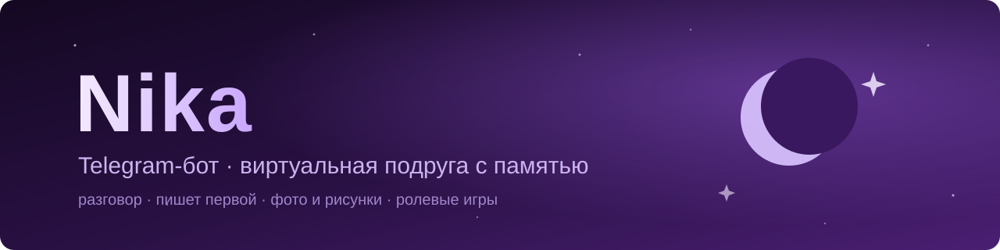

<p align="center">
  
</p>

<p align="center">
  
  
  
  
  
</p>

# Nika

Личный Telegram-бот — виртуальная подруга Ника. Переписывается как живой человек, помнит, о чём мы говорили,
сама пишет первой, понимает фото и иногда присылает свои рисунки, а ещё с ней можно играть в текстовые ролевые игры.

Бот рассчитан на одного пользователя: на сообщения от всех остальных он просто не реагирует.

Работает на Python 3.12, [aiogram 3](https://github.com/aiogram/aiogram), SQLite и любой LLM с OpenAI-совместимым API.
Я гоняю его через [Polza.ai](https://polza.ai) на открытых моделях (DeepSeek, Mistral) — это около 100–150 ₽ в месяц.

## Что умеет

**Разговор.** Пишет коротко, как в мессенджере, может ответить двумя-тремя сообщениями подряд,
показывает «печатает…» и делает паузы. Если написать несколько сообщений подряд, подождёт и ответит на всё сразу.
Характер, внешность, манера речи и интересы задаются в [`persona.yaml`](persona.yaml).

**Память.** Помимо последних ~20 сообщений, в фоне ведётся долгая память:
- факты обо мне (имя, работа, близкие, планы) с важностью от 1 до 5 — важные помнит всегда,
  остальные находит полнотекстовым поиском (SQLite FTS5), когда разговор заходит о похожем;
- события её собственной «жизни», чтобы она себе не противоречила;
- краткая сводка старой переписки;
- список «что спросить потом» — например, как прошло собеседование.

`/memory` показывает, что она помнит, `/forget` — удалить факт.

**Пишет первой.** 3–4 раза в день, со случайным временем: утром после того, как я обычно просыпаюсь,
вечером, когда я долго молчу, или чтобы спросить про событие из памяти. Не пишет ночью
(время сна определяется по `/sleep`, фразам вроде «спокойной ночи» и по истории активности),
не встревает в идущий разговор и не спамит, если ей не ответили. Перед отправкой дешёвая модель
проверяет, уместно ли сейчас писать.

**Фото и картинки.** Мои фото описывает модель с распознаванием изображений, и Ника реагирует на них как человек.
Сама она присылает в основном свои рисунки, скетчи и то, что вокруг (кофе, вид из окна, кошка) —
генератор не умеет держать одно лицо, поэтому «себя» она показывает только автопортретом-скетчем.
Не больше двух картинок в день.

**Отношения.** Уровень близости от 0 до 100 и четыре стадии: знакомые → друзья → близкие друзья → романтика.
Дешёвая модель время от времени оценивает разговоры, рост ограничен (+3 в день), поэтому до близких друзей —
пара недель регулярного общения. От стадии зависит поведение, `/status` показывает её словами.

**Ролевые игры.** `/rp` или просто «го поиграем в ролевку?» — сначала договариваемся о сеттинге и ролях,
потом сцена: действия в *звёздочках*, она ведёт мир и не пишет за моего персонажа.
`((текст в скобках))` — реплика вне роли, `/ooc` — выйти поболтать, `стоп` — сразу остановить,
`/end` — закончить с итогом, `/scenes` — вернуться к старой сцене. Длинные сцены сворачиваются в краткое содержание,
а действия персонажа не попадают в память о реальном мне.

**Надёжность.** Если модель отказала или ответила «как ассистент», роутер повторяет запрос через запасные модели;
можно подключить резервный агрегатор — бот переключится на него, если основной не отвечает.
Расходы считаются в рублях (`/stats`), при 80% месячного бюджета приходит предупреждение,
при 100% бот переходит на дешёвую модель. Каждую ночь делается бэкап базы.

Есть и неотключаемые правила: все персонажи только совершеннолетние, а если в сообщении похоже на кризис —
Ника выходит из флирта и игры, поддерживает и предлагает поговорить с близкими или специалистом.

## Быстрый старт

```bash
git clone https://github.com/liceriusminar-lab/nika-bot.git
cd nika-bot
python -m venv .venv
.venv/bin/pip install -r requirements.txt     # Windows: .\.venv\Scripts\pip install -r requirements.txt
cp .env.example .env                           # и заполнить токен бота, свой Telegram ID и ключ агрегатора
.venv/bin/python -m bot.main
```

Подробно, с получением токена и ключей и выбором модели — в [docs/setup.md](docs/setup.md).
Запуск на сервере через Docker — в [docs/deploy.md](docs/deploy.md).

## Команды

| Команда | Что делает |
|---|---|
| `/start` | знакомство |
| `/rp`, `/ooc`, `/end`, `/scenes`, `/stop` | ролевые игры |
| `/memory`, `/forget <номер>` | что она помнит / забыть факт |
| `/sleep`, `/wake` | ухожу спать / проснулся |
| `/status` | стадия отношений |
| `/settings` | сообщения первой, картинки, стадия, с какой стадии ERP |
| `/stats` | расходы за месяц и баланс агрегатора |
| `/reset` | стереть переписку или вообще всё |

## Как устроено

```
bot/
├── main.py            запуск, планировщик, бэкапы
├── dialogue.py        сборка запроса к модели: персона → память → история → подсказки
├── persona.py         системный промпт из persona.yaml
├── humanize.py        «печатает…», паузы, разбивка ответа на сообщения
├── handlers/          сообщения, фото и команды
├── llm/               OpenAI-совместимый провайдер, роутер с fallback, распознавание отказов
├── memory/            SQLite, факты, сводки, её «жизнь»
├── proactive.py       «пишет первой»
├── sleep.py           определение, сплю ли я
├── relationship.py    уровень близости и стадии
├── roleplay.py        RP-режим и сцены
└── images.py          фото и картинки
tools/                 сравнение моделей, проверка связи, выкладка на сервер
tests/                 pytest, нейросети подменены
```

Пара решений, которые могут быть неочевидны:

- Запрос собирается так, чтобы его начало как можно реже менялось: сначала персона, потом блок памяти,
  потом история, а время, найденные по теме факты и прочие подсказки — в самом конце.
  Тогда провайдер берёт начало из кэша, а это в разы дешевле.
- Подсказки модели приклеиваются к последнему сообщению пользователя в квадратных скобках, а не идут
  отдельным системным сообщением: на системное сообщение в конце DeepSeek иногда отвечает пустотой
  или начинает его продолжать.
- У DeepSeek V4 «размышления» включены по умолчанию и съедают лимит длины ответа, поэтому они выключены
  через `reasoning.enabled = false`.
- Картинку модель «заказывает» меткой `[[картинка: рисунок — что на ней]]` прямо в ответе. Это проще
  и надёжнее вызова функций и одинаково работает с любой моделью.

## Что нового

Список изменений по версиям — в [CHANGELOG.md](CHANGELOG.md).

## Настройки

Всё задаётся в `.env`, каждое поле с комментарием — см. [`.env.example`](.env.example).
Характер — в [`persona.yaml`](persona.yaml), после правки бота нужно перезапустить.
